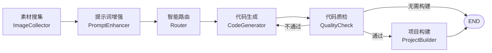

# ai_coder — AI 智能体代码生成平台

基于 **Spring Boot 3 + LangChain4j + LangGraph4j** 构建的对话式 AI 代码生成平台：用户用自然语言描述需求，AI 通过**工具调用**自主编写网页代码（HTML 单页 / 多文件 / Vue 工程），工作流自动完成素材搜集、提示词增强、智能路由、代码生成、质检与构建部署，最终产出可直接预览的网站。


---

## ✨ 核心特性

- **三种生成模式**（`CodeGenTypeEnum`）
  - `HTML`：单文件网页
  - `MULTI_FILE`：多文件网页（HTML / CSS / JS 分离）
  - `VUE_PROJECT`：完整 Vue 工程（自动执行 `npm install` + `npm run build`）
- **AI 自主工具调用**：基于 LangChain4j Tools，AI 可自主执行 `FileWrite` / `FileRead` / `FileModify` / `FileDelete` / `DirRead` / `Exit`，像"AI 程序员"一样自己写文件、改文件
- **SSE 流式输出**：生成过程实时推送到前端，逐字打字机效果 + 阶段事件（工作流开始 / 节点完成 / 完成）
- **LangGraph4j 工作流**：素材搜集 → 提示词增强 → 智能路由 → 代码生成 → 代码质检 → 项目构建，条件边控制构建 / 跳过 / 回退重生成
- **智能路由**：AI 根据对话内容自动判断本次生成类型（单页 / 多文件 / Vue 工程）
- **Agent 长期记忆**：基于 MySQL 的跨会话记忆，自动沉淀用户偏好与项目上下文，注入系统提示词
- **网页截图**：Selenium + Chrome 无头浏览器对生成站点截图，结合腾讯云 COS 生成网站封面
- **一键部署预览**：构建产物 `dist` 按 deployKey 发布，通过 `/static/{deployKey}/**` 直接在线访问
- **会话与历史**：Redis 会话 + 多轮对话上下文 + 对话历史持久化
- **接口文档**：Knife4j（OpenAPI 3），中文界面
- **可观测性预留**：Actuator + Micrometer Prometheus 端点

## 🛠 技术栈

| 层次 | 技术 |
|---|---|
| 基础框架 | Spring Boot 3.5.6、JDK 21（虚拟线程） |
| AI 框架 | LangChain4j 1.1.0（Tools / Reactor 流式）、LangGraph4j 1.6.0 |
| 模型接入 | 阿里云 DashScope（通义千问）+ OpenAI 兼容接口 |
| ORM | MyBatis-Flex 1.11.8 + HikariCP + MySQL 8 |
| 缓存 / 会话 | Redis（Redisson、Spring Session、Caffeine） |
| 存储 | 腾讯云 COS（截图 / 静态产物） |
| 浏览器自动化 | Selenium 4 + WebDriverManager |
| 文档 | Knife4j 4.4 + SpringDoc OpenAPI 2.7 |
| 工具库 | Hutool 5.8、Lombok、AOP |

## 🔄 工作流架构



生成链路：`对话请求 → AI 流式生成 → 工具调用写文件 → npm 构建（Vue 工程）→ dist 发布 → 在线预览 / 截图`

## 🚀 快速开始

### 环境要求

| 依赖 | 版本要求 |
|---|---|
| JDK | 21+（必须，代码使用了 JDK 21 特性） |
| Maven | 3.8+ |
| MySQL | 8.0+ |
| Redis | 6.0+ |
| Node.js | 16+（Vue 工程构建用） |
| Chrome | 本机需可运行（截图用，WebDriverManager 自动装驱动） |

### 配置与启动

1. **克隆项目**

```bash
git clone https://github.com/keluoluo-ha/ai_coder.git
cd ai_coder
```

2. **准备数据库**：创建 MySQL 库，执行 `sql/agent_memory.sql`（Agent 长期记忆表）

3. **填写配置**：复制并修改 `src/main/resources/application-local.yml`（默认激活 `local` profile），关键配置项：

```yaml
# 阿里云 DashScope API Key
# LangChain4j OpenAI 兼容接口（base-url / api-key / model-name）
# MySQL 数据源（url / username / password）
# Redis 连接
# 腾讯云 COS（secretId / secretKey / bucket / region）
```

4. **启动**

```bash
mvn spring-boot:run
```

5. **访问接口文档**：启动后打开 `http://localhost:8080/api/doc.html`（Knife4j 中文界面；服务端口与 context-path 以 `application-local.yml` 中 `server` 配置为准）

## 📁 项目结构

```
src/main/java/com/hhk/aicoder/
├── ai/                 # AI 服务层：生成服务工厂、智能路由、Guardrails、Tools
│   ├── tools/          #   FileWrite / FileRead / FileModify / FileDelete / DirRead / Exit
│   ├── model/          #   AI 响应模型（HTML / MULTI_FILE / VUE_PROJECT）
│   └── guardrial/      #   输出校验
├── langgraph4j/        # 工作流：图定义、节点（搜集/增强/路由/生成/质检/构建）、上下文
├── controller/         # App（对话生成/部署）、ChatHistory、User、StaticResource
├── service/            # 业务服务（含 VueProjectBuilder 构建、截图上传）
├── core/               # SSE 流处理核心（handler / 心跳与流式解析）
├── monitor/            # 可观测性（模型监听器 / Micrometer 指标）
├── ratelimiter/        # 限流（注解 + AOP 切面）
├── config/             # 配置类（AI 模型、Redis、Web、线程池等）
├── mapper/ model/ common/ exception/ utils/ ...
```

## 📌 主要接口

| 接口 | 说明 |
|---|---|
| `GET /app/chat/gen/code` | 对话式生成代码（SSE 流式） |
| `POST /app/deploy` | 一键部署生成的应用 |
| `/static/{deployKey}/**` | 已部署应用在线预览 |
| `ChatHistoryController` | 对话历史增删查 |
| `UserController` | 用户登录 / 注册 |
| `GET /v3/api-docs` / `/doc.html` | OpenAPI 文档（Knife4j） |

> 完整接口以 `/doc.html` 为准。上表为 Controller 内部路径，实际请求需加上 context-path `/api` 前缀（如 `/api/app/chat/gen/code`）。

## 🧠 设计亮点

1. **AI 自主性**：不采用"模板填充"，而是让模型通过 Tools 真实地创建 / 修改文件，由 Exit 工具声明任务结束
2. **流式全链路**：模型 Token 流 → Reactor Flux → SSE，前端打字机实时渲染，工具调用过程可见
3. **图驱动的工作流**：LangGraph4j 节点 + 条件边，质检不通过可回退重新生成，构建可按路由结果跳过
4. **跨线程上下文**：`WorkflowContext` 经 `MessagesState` 在节点间共享状态
5. **长期记忆注入**：每次对话前自动检索记忆并拼入系统提示词，越用越懂你

## 📄 License

本项目为个人学习 / 课程设计项目，仅供学习交流使用。

## 🙏 致谢

- [LangChain4j](https://github.com/langchain4j/langchain4j)
- [LangGraph4j](https://github.com/bsorrentino/langgraph4j)
- [Spring Boot](https://spring.io/projects/spring-boot)
